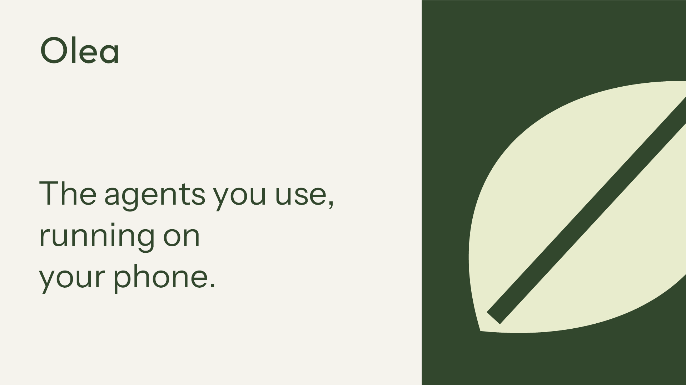

  

# Olea

**Bring Pi, Codex and Claude Code to your Android phone.**

Give an agent a task, follow its replies and tools, and return to the conversation later. Olea brings the agent, its working files and phone controls into one app. Your computer can stay off.

[Download & release notes](https://github.com/nekoium/Olea/releases) · [Report a problem](https://github.com/nekoium/Olea/issues) · [MIT license](LICENSE)

> **Early release:** 0.1.0 is being prepared. Use the release page to check APK availability and tested devices before installing. Device compatibility and background reliability are still limited.

## A workspace in your pocket

An agent can do more than answer questions: it can read and change files, run commands and use tools. Olea gives that work a home on your phone.

- **Pick your agent.** Choose Pi, Codex or Claude Code for each new conversation. Add other agents later.
- **Keep projects together.** A workspace is a folder for a project's files, with its conversations alongside it.
- **See the work.** Follow replies and tool activity, send a follow-up, or stop execution when you need to.
- **Return to a task.** Saved conversations let you review earlier work and continue with the same agent.
- **Connect phone capabilities.** Let agents use the Android access you explicitly enable, such as opening a web link or interacting with an accessible screen.

For a first task, try:

> Create a file called hello.txt in this workspace containing “Hello from Olea”, then read it back to me.

Once that works, try summarizing a text file in the workspace, making a small script, or asking the agent to explain and edit a project. Check changes before relying on them. For a phone task, enable phone tools and ask it to open `https://example.com` in your browser.

**The agent runs on your phone; the AI model usually runs at your provider.** A provider is the service that generates the agent's replies. Olea does not require a desktop relay or your own always-on server, but model requests still need a working connection to that service.

## Install and get your first reply

You need an **ARM64 Android phone** for the planned 0.1.0 APK. Olea has been tested on a physical phone running **Android 14**; other Android versions and devices are not yet verified. You also need internet access, free storage for its Linux environment and tools, and credentials for a compatible model provider. Root access and a connected computer are not required for normal use.

1. **Download the ARM64 APK** from [Olea Releases](https://github.com/nekoium/Olea/releases) when 0.1.0 is available. An APK is Android's app installer. Read the release's device requirements and known issues before installing.
2. **Open the downloaded file.** If Android asks, allow your browser or file manager to install apps from that source, then install Olea. You can turn that permission off afterward.
3. **Open Olea and choose Get started.** Choose your agent and a workspace. A managed workspace keeps its files inside Olea.
4. **Prepare the environment and install your agent.** Follow setup's progress and wait for completion. This downloads packages and can take several minutes. If setup fails, read the error, check connectivity and storage, then retry explicitly.
5. **Configure the provider.** Enter the provider's API base URL, model ID and API key. The base URL is its connection address; the model ID is the exact model name it supplies. See the agent choices below. Stop the environment before changing provider settings.
6. **Review phone access or skip it.** You can chat and work with workspace files without optional phone permissions. Enable those capabilities later when a task needs them.
7. **Open the conversation.** Start or reconnect it if prompted, then send the `hello.txt` task above. If Olea keeps your text as a draft while connecting, press Send when ready. Confirm that the reply reports the file's contents.

A saved provider configuration does not prove the connection works: the first reply checks it. For connection errors, check the URL, model, key and provider balance under **Providers** in the app menu. Installing an agent alone does not include model access.

## Choose an agent and model service

| Agent | Provider connection |
| --- | --- |
| **Pi** | Configure a provider supporting the OpenAI Responses API and your chosen model. |
| **Codex** | Configure a provider supporting the OpenAI Responses API and your chosen model. |
| **Claude Code** | Configure a provider supporting the Anthropic Messages API and your chosen Claude model. |

Use the provider's documented API address and credentials. Similar-looking API services are not always interchangeable. A consumer chat subscription may not include API access; check with your provider before paying. Agent-specific account login options depend on the upstream agent and are not a shared Olea sign-in.

Olea's original code is free and open source. **Your provider may charge for messages, reasoning and tool results.** Olea does not include credits or a spending cap. Set limits with your provider where available, and start with a small task.

One conversation keeps one agent. To use another, create a new conversation. Agents share the local environment and can access files available to Olea; separate workspaces help organize projects but do not isolate them from one another.

## Choose where your files live

A **managed workspace** keeps files inside Olea. A **connected folder** works directly with an existing folder in your phone's primary shared storage—the built-in storage you see in a file manager. Agent edits change those original files immediately; Olea does not make a separate working copy.

Stop the environment before connecting a folder. Under **Workspaces → Create workspace**, choose **Connect existing folder**. Follow **Open Android storage settings** to grant **All files access**, return to Olea, browse to your folder and choose **Connect this folder**. You can also explicitly create a visible Olea folder there. This broad Android grant covers more than the chosen folder; it is not a permission limited to that one workspace. Android still protects other apps' private data. Use a managed workspace if you do not want to grant it.

Connected folders support reading and writing ordinary files. Shared storage restricts running program files directly, symbolic links and some Linux file behavior, so package installation and projects that depend on those features may fail there. Keep executable tools and such projects in a managed workspace. Removable cards and cloud/document-provider folders are not supported as connected workspaces.

If access is revoked or the connected folder disappears, Olea blocks work in that workspace instead of creating a replacement folder. Restore access or the original folder, then follow the recovery message; a stopped environment may need restarting. Saved conversations remain available, and you can still use managed workspaces.

## Phone access stays in your hands

Open **Phone access** from the app menu to review access and enable phone tools. Enabling tools and granting Android permissions are separate steps.

- **Accessibility** can expose screen text and controls, clicks and gestures. Enable Olea in Android's Accessibility settings only if you want this access. Some apps expose little or no usable screen information.
- **Browser links** ask Android to open an HTTPS address. A successful request does not guarantee that the page loaded.
- **Location and notifications** require their respective Android grants. Location can be stale or unavailable; notification access can reveal sensitive messages from other apps.
- **Selected-folder tools** use Android's folder picker for a limited text write/read operation. That narrower grant is separate from connecting a workspace, which requires the broader All files access described above.
- **Screen capture** needs Android's consent for each request. Protected content may be blank. The current tool returns capture status and image metadata, not image pixels to the model.

Phone tools start disabled after a process restart. **STOP** disables them and interrupts agent execution and shells; **Cancel turn** requests interruption of the selected conversation's current task. STOP cannot undo a completed file change or an action already sent to Android. Android permissions can remain granted after STOP; you can revoke them in Android settings.

Olea cannot bypass Android permissions or read every app's private data. Give agents tasks and access you trust them to use.

## Your files, privacy and recovery

Managed workspace files, saved conversations, agent settings and credentials are kept in Olea's private app storage. Connected workspace files stay in the shared folder you chose. The model provider receives the messages and tool results the agent sends, which can include file contents and phone information. Commands and installed tools may also contact external services. Running the agent locally does not make its work offline or confidential from your chosen provider.

Agents can execute commands and change files with broad authority. Olea's Linux environment provides compatibility, **not a security sandbox between agents, files and credentials**. Review generated work and avoid placing sensitive material in reach of an agent you do not trust.

**Back up important files separately. Uninstalling Olea or clearing its Android storage deletes managed workspace files, conversations and credentials.** Connected-folder files remain in shared storage, but agent edits to them are direct and Olea provides no undo or backup. Built-in export and backup are not available yet. Ordinary compatible APK updates are intended to keep app data; do not uninstall to resolve an update error without first preserving your files. The first public APK installs separately from earlier development builds and does not import their files or conversations.

Android can stop background processes, especially under battery or memory pressure. Reopen Olea, inspect the conversation and reconnect before deciding whether to send an interrupted task again. Reconnecting does not automatically resend earlier prompts. A **Done** state means the agent finished a turn; check its answer and files to confirm your task succeeded.

## Before you rely on it

Olea is an early Android release. Pi's file work, interruption and saved continuation, all three agents' replies, and browser/Accessibility actions have been checked on the Android 14 ARM64 phone. These checks do not establish equal tool coverage across agents or compatibility with every app. Use each release's notes for the exact devices and agent versions checked. Continuous background execution, operation through reboot and compatibility with every future agent update are not guaranteed.

Scheduled tasks, reminders, alarms and general phone-folder cleanup are not included. Olea currently focuses on conversations, managed or connected workspace files and permission-controlled phone tools. It is not available for iOS.

## Help and contribute

Have an idea, a question or feedback? [Join the Discord conversation](https://discord.gg/X8mCdDzz8).

For setup problems or bugs, [open an issue](https://github.com/nekoium/Olea/issues) with your Olea version, Android version, device model, chosen agent and the steps that failed. Remove API keys, private messages and personal files from logs or screenshots before sharing them.

Want to build from source or contribute? See [Contributing](CONTRIBUTING.md).

Original Olea code is available under the [MIT License](LICENSE). Bundled runtime components, Android interface libraries and agents retain their own licenses. See [third-party components](runtime/THIRD_PARTY.md) and [Android interface notices](runtime/licenses/Android-UI-NOTICES.txt). When downloading an APK, also keep its accompanying runtime NOTICES and runtime source companion from the same release page; these provide license texts, corresponding runtime source and build/replacement instructions.
