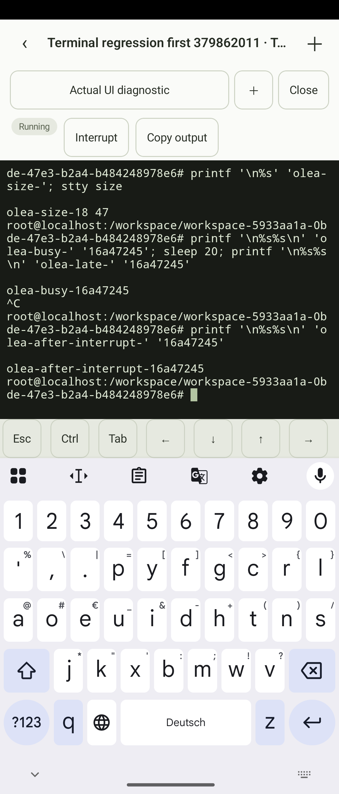
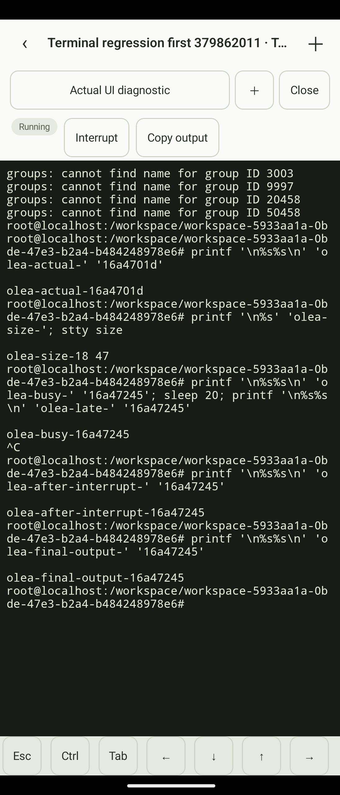
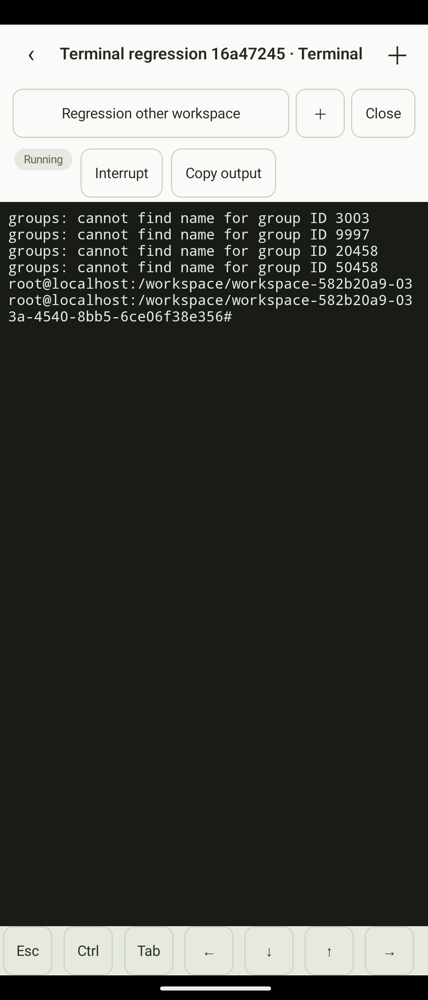
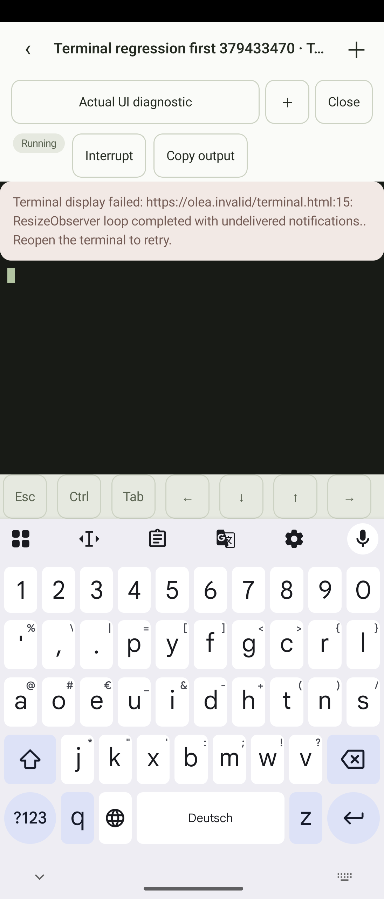

# Issue #1: blank terminal in ordinary app flow

**OBSERVED**: The rendering defect is fixed in source and passes the complete physical-phone regression through the original `MainActivity` composition. Screenshots show a real shell prompt, executed command output, Ctrl-C continuation, keyboard resizing, and output in another workspace. The selected shell also survives navigation away and back. GitHub #1 remains open for coordinator review.

## Cause and change

**OBSERVED**: `terminal.html` registered a `ResizeObserver` on the same terminal root that `fit()` resizes. On this phone, ordinary activity layout produced `ResizeObserver loop completed with undelivered notifications.` The production console-error callback treated that error as a terminal load failure, set `ready=false`, and stopped forwarding subsequent runtime output. The PTY continued to run. This explains why runtime/buffer checks from other compositions did not establish ordinary visible output.

**OBSERVED**: Removed that redundant observer. Initial fitting still runs at bootstrap, and WebView's window `resize` event still fits the terminal and sends its new dimensions to the PTY. No error suppression, PTY transport change, or terminal-control restriction was added. Restoring only the observer in a temporary device build reproduced the exact error, zero bright samples, and missing command output with the final diagnostic; restoring the fix passed.

**OBSERVED**: The complete navigation regression exposed a second defect: leaving the terminal disposed its local saved selection, so returning selected the last-created shell. `OleaApp` now wraps each workspace's terminal in a `rememberSaveableStateHolder` provider. It preserves the existing local selected-shell state while the screen is absent. Returning replays that shell's retained output into a new WebView.

## Physical evidence

**OBSERVED**: Device `QV7708SZCK`, Sony XQ-CT72, ARM64, Android 14 / API 34, Google Android WebView `157.0.8103.50`. Every ADB operation selected this serial explicitly.

**OBSERVED**: The normal installed `dev.olea` APK reproduced the blank display. Its SHA-256 was `00553730906e2b9a6cd70dc33bebff53ebba83c2d9c09a19e3ed1ba86833844c`. Its installed package path remained unchanged after testing. Release-signing credentials were unavailable, so verification used a separate debug application, `dev.olea.terminaltest`, and test package `dev.olea.terminaltest.test`. This package uses the production sources, original `MainActivity.setContent`, real runtime, packaged Python PTY, and ordinary accessibility navigation. The `actual` case does not replace composition or inject a layout correction.

**OBSERVED**: The tested target SHA-256 is `b0bd0fc9a9ee87adac8cf8d91d45f1f681f2596646a12de50ec4cab3cfd950d6`; test APK SHA-256 is `c0d116bc515f8eb9d9716e25e52cd3b34be1a71f2e5e76cf0e24d73edd66ffce`. Preserved local copies are `.setup/issue-triage/olea-terminaltest-debug.apk` and `.setup/issue-triage/olea-terminaltest-debug-androidTest.apk`.

| Check | Physical result |
| --- | --- |
| Prompt and command output | Native WebView pixels and screenshots show prompt and executed printf markers. |
| Keyboard show/hide | Actual IME visibility checked; terminal expands to 43 rows and shrinks to 18 rows, at 47 columns. |
| Real PTY resize | `stty size` returns `18 47`, matching xterm after keyboard resize. |
| Ctrl-C | Production Ctrl button plus `c` interrupts foreground `sleep 20`; following printf completes in 1,282 ms; delayed marker absent. |
| Session switching | Two shells in the first workspace retain separate output; switching back shows the first shell's output. |
| Leave and return | Ordinary Back / Terminal navigation preserves the first selected shell and painted output. |
| Second workspace | Another synthetic managed workspace shows its own prompt/output; returning restores the first workspace's selected shell/output. |
| Data and providers | Original conversation selection preserved; only diagnostic shells closed; backend stopped only when the diagnostic started it; zero provider requests. |

**OBSERVED**: [Compact receipt](evidence/1-terminal/receipt.json) contains artifact identity, the failed observer and selection regressions, final assertions, native bounds/IME state, DOM geometry, and sampled text pixels. Full local receipts remain in `.setup/issue-triage/final-actual.txt`, `counterfactual-observer.txt`, and `regression-first.txt`.









## Repeat the focused check

**OBSERVED**: The opt-in diagnostic initialization script now supports a coexisting test app through `-PoleaTerminalTestApp=true`. It leaves the normal application identity unchanged when omitted. With the repository's JDK/SDK/Gradle environment configured, build from the repository root:

```sh
.setup/core/gradle-9.1.0/bin/gradle -p android --no-daemon \
  -PoleaAbi=arm64-v8a -I terminal-webview-diagnostic.init.gradle \
  -PoleaTerminalTestApp=true :app:assembleDebug :app:assembleDebugAndroidTest \
  --max-workers=2
adb -s QV7708SZCK install -r android/app/build/outputs/apk/debug/app-debug.apk
adb -s QV7708SZCK install -r -t android/app/build/outputs/apk/androidTest/debug/app-debug-androidTest.apk
adb -s QV7708SZCK shell am instrument -w -r -e case actual \
  dev.olea.terminaltest.test/dev.olea.app.TerminalWebViewInstrumentation
```

**OBSERVED**: A fresh coexisting package needs network access for normal Linux package preparation; no agent or provider is opened. The actual-flow diagnostic prepares only this explicitly named test package, creates uniquely named managed workspaces, uses synthetic printf/sleep/stty commands, and saves screenshots in its private files directory. Synthetic workspace records remain available for inspection. Screenshots can be retrieved with `adb -s QV7708SZCK exec-out run-as dev.olea.terminaltest cat files/terminal-after-interrupt.png` and the equivalent `terminal-other-workspace.png` / `terminal-final-output.png` paths. Redirect binary output with a shell that preserves bytes. Production package diagnostics still require an already-prepared environment and a matching test signature.

**OBSERVED**: Focused Gradle production/test assembly and `git diff --check` pass. The final build log is `.setup/issue-triage/build.log`. No backend or runtime source changed, so unrelated backend/provider suites were not repeated.

## Failed attempts and limits

**OBSERVED**: Earlier failures remain local evidence: `terminal-baseline.txt` / `live-baseline.txt` show the installed app failure; `isolated-baseline.txt` records the first 240-second fresh-environment preparation timeout. Normal package installation was then completed in the isolated test environment; its preparation allowance is now 1,200 seconds. Temporary diagnostic buffer inspection initially caused its own early JavaScript `TypeError`; `observer-labels.txt` retains that failure, and that probe was removed. `regression-first.txt` records the real lost-selection defect before the state-holder fix. `regression-preserved.txt` records a diagnostic navigation error that looked for Workspaces inside the app menu; the check now uses the ordinary bottom Workspaces control. `counterfactual-observer-cutoff.txt` retains an invocation cut off by the host command deadline, followed by the complete failing counterfactual receipt. None of these failed runs is counted as acceptance.

**OPEN**: This is physical acceptance of the shared production implementation in the coexisting debug package on one phone/WebView/keyboard combination. The official installed package and published release were not replaced. A future release-signed APK has not been built, installed, or accepted here. General OEM compatibility and process-death recovery are outside this result. Existing shell startup messages about Android group IDs remain visible; they do not prevent prompt or command output. Historical issue #2 frame-hardening work was not expanded, and intended terminal control remains intact.
