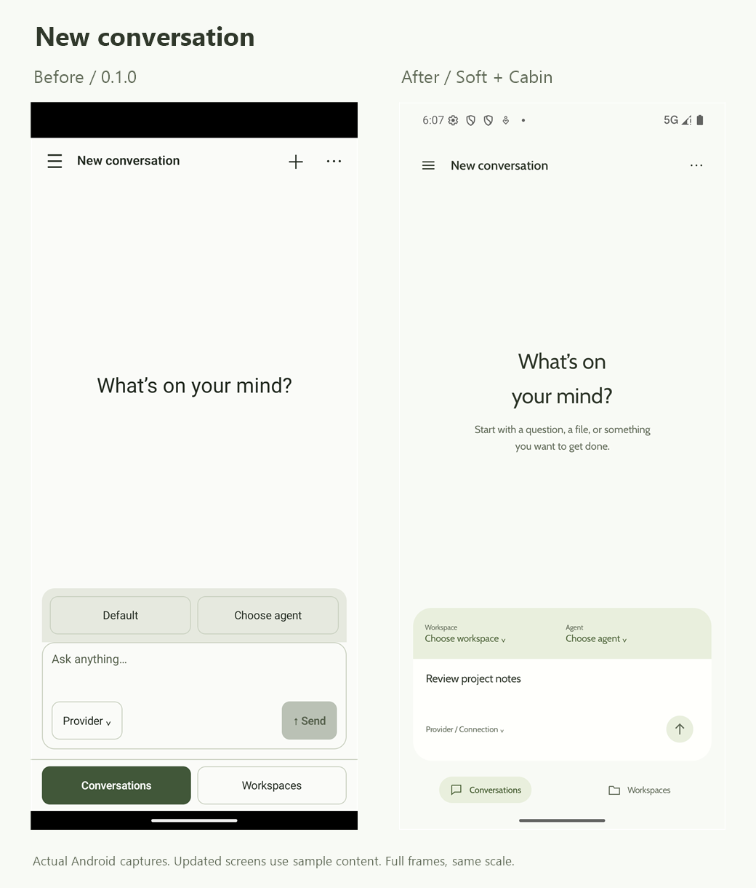
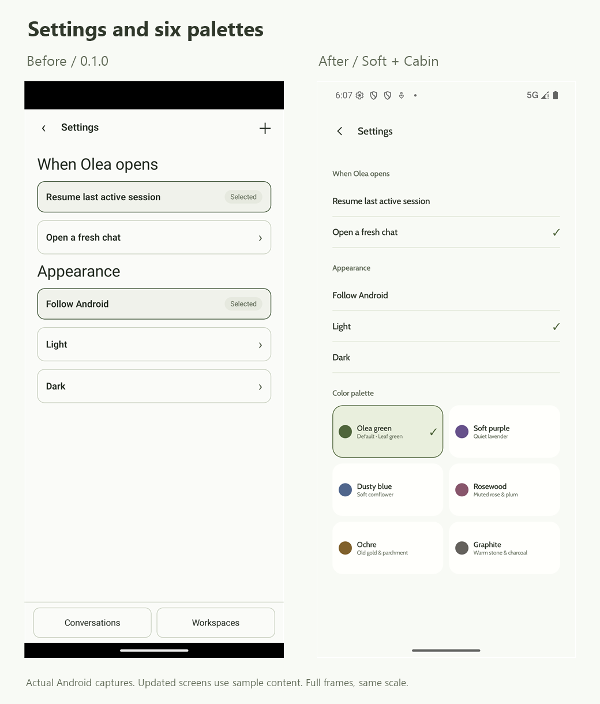
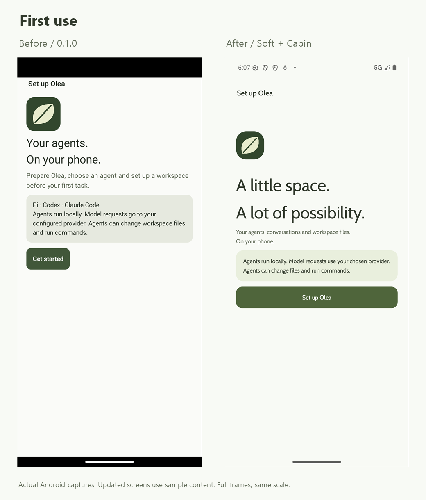
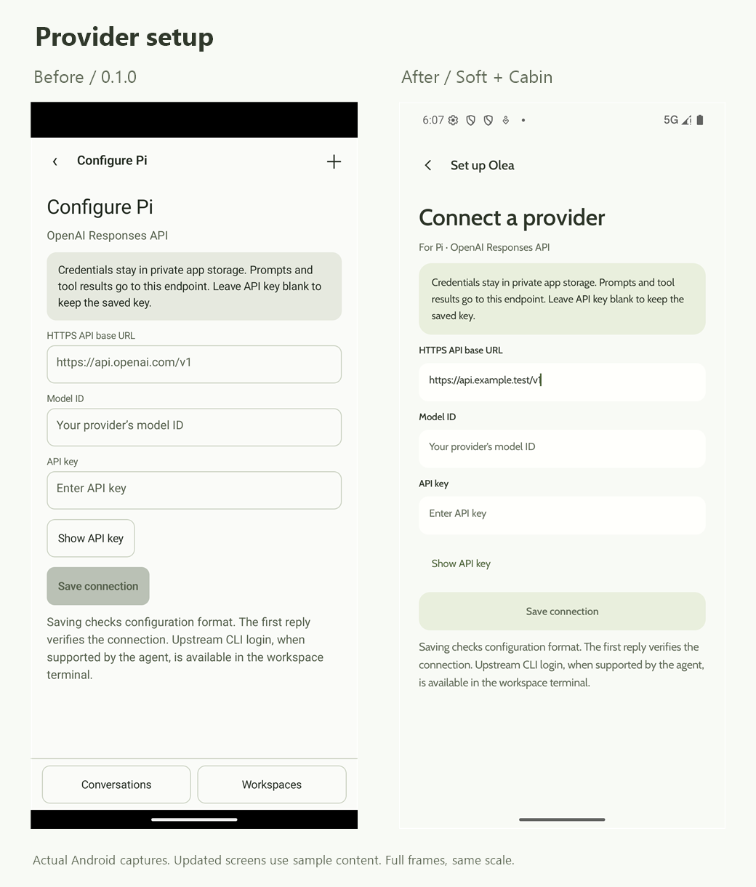
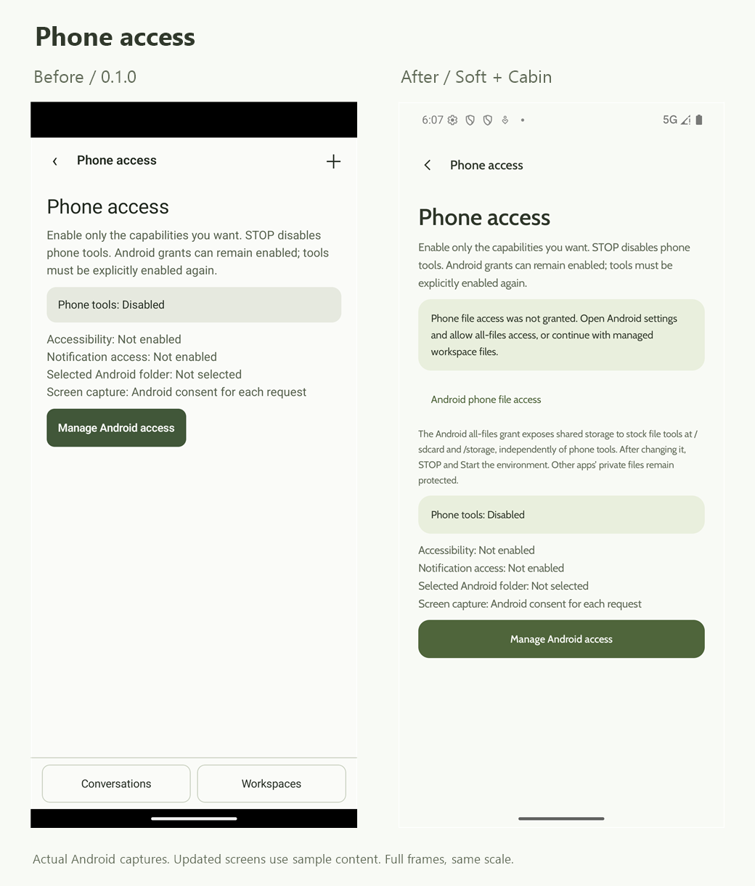

# Olea 0.1.1 — The Soft UI update

Olea has a new native interface: softer shapes, quieter navigation, a joined conversation composer, and **Cabin** typography throughout. Choose from six coordinated palettes in light or dark mode, with **Olea green** as the default.

## Download and update

- [Signed ARM64 APK](https://github.com/nekoium/Olea/releases/download/0.1.1/olea-0.1.1-arm64-v8a.apk)
- [Runtime notices](https://github.com/nekoium/Olea/releases/download/0.1.1/olea-0.1.1-runtime-NOTICES.txt)
- [Corresponding runtime source and replacement instructions](https://github.com/nekoium/Olea/releases/download/0.1.1/olea-0.1.1-runtime-source.tar.gz)
- [SHA-256 checksums](https://github.com/nekoium/Olea/releases/download/0.1.1/SHA256SUMS.txt)

Install over the official 0.1.0 app to keep your data. **Do not uninstall or clear app storage to update.** This APK uses the same package and signing identity as 0.1.0. ARM64 only; Android 8/API 26 is the declared minimum, with broader device compatibility still unverified.

## What changed

- Rebuilt conversation, setup, workspaces, files, management, phone-access and terminal presentation around the Soft design.
- Bundled Cabin locally, including its open-font license and real font weights. Code and terminal text remain monospace.
- Added **Olea green, Soft purple, Dusty blue, Rosewood, Ochre, and Graphite**. Palette and light/dark appearance save separately.
- Joined workspace and agent selection to the new-conversation composer, and reduced the visual weight of navigation.
- Updated the app icon to match the rounded Olea artwork.
- Included the terminal resize and workspace-shell selection fix from #1.
- Included broad shared-phone-file access from #13: after Android grants all-files access, stock agent tools can reach available shared files outside the workspace through `/sdcard` and `/storage`. Workspaces set the starting directory; they do not restrict file reach. Other apps' private data remains protected. After changing the grant, STOP and Start the environment to refresh bindings.

## Before and after

View the five before-and-after comparisons

Each pair shows **0.1.0 on the left** and **the native Soft interface with Cabin on the right**. Click a preview to open the full-size image. These are actual Android emulator captures. Updated screens use sample content; preferences, form contents and permission state can differ between installations.

### New conversation

The joined composer keeps workspace, agent and provider choices together. Navigation stays quieter beneath it.

### Settings and palettes

Compact preference rows and six complete color palettes, with Olea green selected.

### First use

A calmer welcome, clearer type hierarchy, and one main setup action.

### Provider setup

Consistent fields, grouped information, and a full-width save action.

### Phone access

Updated capability status and Android access controls, including the shared-file access information added since 0.1.0.

## Current limits

The new interface was checked on an Android 16/API 36 emulator, including narrow layouts, enlarged text, the actual Android keyboard, palette continuity, and real local terminal commands. The signed ARM64 release APK also installed over 0.1.0 and reopened at the same setup step on that emulator. **This update has not been tested on a physical phone or with fresh provider-backed AI conversations.** Earlier Android 14 phone checks belong to 0.1.0 and its terminal follow-up.

Older Android/OEM font rendering and untested language scripts may differ. System keyboards and permission dialogs use Android's typography. The terminal remains experimental; its fixes and bounded checks do not establish compatibility with every device.

Android can stop background processes. Saved conversations persist, but running shells do not survive process death. Backup/export, scheduled tasks, reminders and alarms remain unavailable. Back up important files separately; agents can directly change files available through Olea's Android grants.

## Licenses

Olea's original code is MIT. Cabin is distributed under the SIL Open Font License. Bundled Ubuntu Base, Node, PRoot, talloc, libandroid-shmem and other components retain their licenses. Keep the runtime notices and source companion with redistributed APKs; the companion provides exact sources, build recipes and library replacement/re-signing instructions. You may modify talloc and reverse engineer the combined runtime to debug those modifications.

[Read the guide](https://github.com/nekoium/Olea#readme) · [Report a problem](https://github.com/nekoium/Olea/issues) · [Discord](https://discord.gg/X8mCdDzz8)
